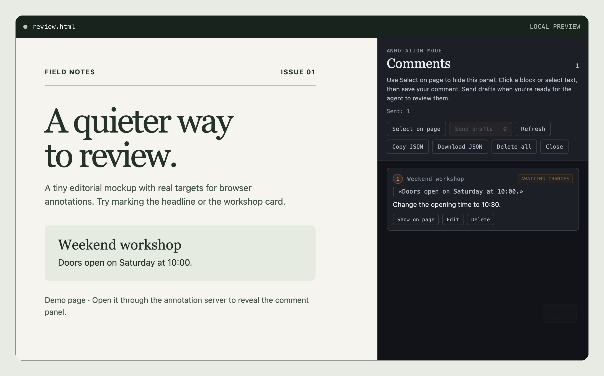

# html-annotate

**Give feedback on a local HTML page without leaving the browser.** Click the exact block or select text, write what should change, then send your comments to your coding agent. The agent edits the original HTML; the panel shows which comments are fixed.

[Requirements](#requirements) · [Install](#install) · [First review](#first-review) · [Try the demo](#try-the-demo)



The overlay is added when the page is served locally. It doesn't add scripts or styles to your source HTML.

## Requirements

| When | What you need |
| --- | --- |
| Install | Node.js with `npx` and access to GitHub and the npm registry |
| Run | Python **3.9+** on macOS, Linux or another POSIX environment; a modern browser that can reach `127.0.0.1` |
| Apply feedback | A coding agent with skills support, shell access to start a local server, and permission to edit the HTML. If it can't receive background notifications, tell it in chat when your comments are ready. |

Node.js is only needed to install the skill. No Python packages, browser extension, or hosted service needed.

## Install

Run once for all your projects:

```sh
npx --yes skills add buurzx/html-annotate --skill html-annotate --global --agent codex cursor claude-code --yes
```

Codex and Cursor use the copy in `~/.agents/skills/`, as does omp. The installer also links it for Claude Code. For a different supported host, change the `--agent` targets.

## First review

1. Open your project in the agent and ask: **“Open `mockup.html` for review with `html-annotate`.”** Use the local URL the agent gives you, not `file://`.
2. Press **Alt+A** or click **Comments**. Select text or click a block, write your feedback, and click **Save**.
3. Click **Send drafts**. After the agent applies the changes, the panel shows **Fixed**. Reload the page to see the changed HTML.

On desktop, the panel floats by default. Drag it by **Drag panel**, or choose **Dock right** to place it beside the page. **Undock** restores the floating position. In either layout, **Esc** or **Hide** collapses the panel without discarding your text. Click **Comments** to resume before reloading.

## Try the demo

To preview the overlay without an agent, clone this repository and run the server against the included [sample page](examples/review.html):

```sh
git clone https://github.com/buurzx/html-annotate.git
cd html-annotate
python3 -u scripts/annotate_server.py --root examples --port 0 --state-dir "$(mktemp -d)"
```

Open the `http://127.0.0.1:<port>/` URL printed by the server and append `review.html`. You can save and send comments in the demo; applying them to the HTML still requires an agent. Stop the server with **Ctrl+C**.

## Where the data goes

By default, drafts and sent batches stay in `.annotate/` under the project being reviewed. Installing globally does not share comments between projects. Run one server per page; for simultaneous reviews, use different ports and state directories.

The server is local-only and serves files from its configured root. Point it at a folder of trusted HTML and assets, not a directory containing secrets. It's designed for static pages, not hosted collaboration or live app debugging.

## Development

See [SKILL.md](SKILL.md) for the agent workflow and API. Run the integration tests with `python3 -B -m unittest discover -s tests -v`.
Open `tests/panel-focus.html` directly in a browser to check keyboard navigation and draft restoration. It displays `PASS` or the failed check.

[MIT license](LICENSE) · [Releases](https://github.com/buurzx/html-annotate/releases)
